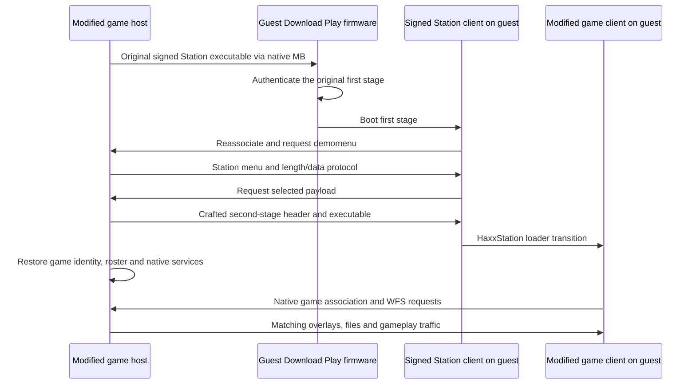

# Serving a modified DS game through Download Play with HaxxStation

This guide explains the boot chain used by this mod and how to adapt the
approach to another Nintendo DS game. The reusable part is the sequence of
loaders, transfers, authentication checks and session transitions. A game's
addresses, SDK structures, startup assumptions and multiplayer rules must be
investigated separately.

**HaxxStation does not create a Nintendo RSA signature for a modified game.**
The receiving DS first authenticates and runs an unchanged, signed Download
Station client. HaxxStation then exploits that client's handling of a subsequent
payload. Our cartridge implements the server needed by that client and returns
the receiving systems to the game's own multiplayer and filesystem service.

The boot chain has run in stock melonDS cores and on the user's physical
Download Play systems. The co-op mod still has performance and campaign work
remaining. Successful unsigned execution, successful game-session handoff and
complete multiplayer gameplay are three separate milestones.

## 1. Components and terminology

| Component | Role |
| --- | --- |
| Host cartridge | Modified game running on the system with a cartridge or flashcart; supplies all downloaded material. |
| Download Play firmware | Guest's normal DS-mode Download Play application; authenticates the initial executable. |
| Signed first stage | Original Download Station `mb/ds_demo_client.srl`, with its original authentication material. |
| Station menu | Downloaded `ds_demo/demomenu` data, including the menu construction used by HaxxStation. |
| Second-stage payload | HaxxStation-wrapped executable, stored as `ds_demo/rom0000d` for the single-payload package used here. |
| Game client | Executable-only guest build; later obtains game assets from the host. |
| MB / WM | Nintendo's multiboot and wireless-manager facilities; these are local DS wireless protocols, not TCP/IP. |
| WFS | The game's wireless filesystem, used to serve overlays and assets after game startup. |
| GGID | Wireless game-group identity used during discovery/association. |
| TGID | Temporary group identity; its lifecycle can matter across restarts and handoffs. |
| AID | Association ID assigned by the radio parent. It is not a permanent player identity. |

The signed first stage and game client are different executables. The small
parent bootstrap that we insert into the host is a third piece of code; it
implements the server and does not run on the guests as their game executable.



## 2. The authentication boundaries

There are several checks to keep separate.

### Initial Download Play authentication

The firmware expects an authenticated initial executable. Modifying that
executable and recomputing an ordinary NDS header CRC does not produce a valid
Nintendo signature. Replacing the entire initial MB image with your modified
retail game therefore does not solve the problem.

Our solution offers the original signed Station client at this boundary. The
package builder verifies that both `mb/ds_demo_client.srl` and
`mb/ds_demo_client.sgn` match the supplied Station dump byte for byte. The host
uses the original SRL and its authentication trailer when constructing the
native MB boot buffer; it does not independently sign anything.

### HaxxStation's second-stage load

The already running Station client downloads further material from its parent.
The upstream patcher constructs the menu and crafted payload for this path.
In the pinned `dspatch` implementation, `AddRom()` changes the second-stage
header's ARM9 source offset to `0x180`, load destination to `0x02332c40`
(the source labels this `rsa_GetDecodedHash`) and size to `0x100`. It places an
exploit stub in the wrapper and records the intended executable's original
locations and sizes in that stub.

This redirects a load onto verification-related code in the signed client's
RAM. The wrapper is part of the exploit; its header no longer describes the
intended game's ARM9 in the ordinary way. Use the upstream packer rather than
"repairing" those fields afterward. Its constants belong to the supported
Station client, not to arbitrary games or arbitrary Station releases.

The patcher also includes an ARM7 relocation shim for payloads whose ARM7 load
address is in the `0x03000000` range. That handling is another reason to inspect
the produced wrapper instead of assuming it is an unmodified `.nds` file.

### Checks performed by the game itself

A game can authenticate overlays or downloaded resources after its ARM9 starts.
HaxxStation does not automatically disable or update those checks.

SM64DS verifies overlay bytes with HMAC-SHA1 against a table in ARM9. Our parent
changes overlay 75. The guest ARM9 therefore needs a digest for the exact
modified overlay that its WFS server will return. We update that guest table
and keep overlay authentication enabled. Updating the table is possible because
this guest executable is now the second stage, not the firmware-authenticated
first stage.

For another title, determine whether it checks encoded or decoded overlay bytes,
where expected digests come from, which flags are mandatory and whether it has
additional resource checks. A successful game entry point followed by an overlay
failure is a different problem from a rejected initial Download Play signature.

Header CRC16 values are structural checks, not replacements for either RSA or
HMAC authentication.

## 3. Start with a standalone probe

Before integrating anything into another game, establish that the original
Station client and upstream exploit work with your inputs and test systems.

The pinned upstream patcher accepts the USA Download Station Volume 1 dump with
SHA-1 `F18B55F3E1259C03E10D0ECB549693B42905CEB5`. Its command-line program rejects
other inputs. This identifies the required revision; it is not a download URL.
Use your own dump and keep it unchanged.

With a built `dspatch` executable or a local launcher for it:

```sh
dspatch -s /path/to/download-station-volume-1-usa.nds \
  -i /path/to/unsigned-probe.nds \
  -o /path/to/haxxstation-probe.nds
```

That output is a **Station host package**. Run it as a host and select it through
normal Download Play on a guest. It is not a newly signed version of the input
probe, and it does not add the original game's multiplayer handoff.

Use a minimal probe that produces an unmistakable result before ordinary game
initialization: for example, a small homebrew screen or a marker written by the
probe's own code to a known safe address. Choose that address from the probe's
memory map. Read-only emulator inspection can observe it; injecting the marker
from the debugger would not prove the boot chain.

Our [`bootstrap/build_probe.py`](bootstrap/build_probe.py) constructs such a
pre-CRT0 marker probe. Its SM64DS addresses are examples, not a portable scratch
memory allocation strategy.

Also distinguish this workflow from
[`wii-ds-rom-sender`](https://github.com/FIX94/wii-ds-rom-sender). That project
supplies a Wii-side sender and incorporates HaxxStation packaging. It is useful
as a second implementation reference; a DS cartridge host still needs a DS-side
server. Its user-adjustable delay setting is not a substitute for correct
acknowledgment handling in an embedded game server.

## 4. Inventory the target game's Download Play path

A game with an existing single-cartridge mode provides useful infrastructure:
MB image generation, parent beacons, ARM7 radio commands, child association,
startup parameters and often WFS. Locate those boundaries before patching.

Record the following for the exact region and revision you support:

- How the parent obtains the initial child executable, its header and signature
  trailer, and how it packs those into MB's transfer buffer.
- The MB parent tick, receive callback, control sender and WM parent events.
- Port callback registration and the function used to submit port data.
- SDK return conventions: a request being accepted is usually different from its
  asynchronous completion succeeding.
- Game discovery identifiers, channel selection, beacon attributes and TGID
  changes across parent shutdown/start.
- How downloaded startup is distinguished from cartridge startup.
- What the guest expects in retained boot memory and how it discovers the game
  host after CRT0.
- WFS initialization, file-table sizes, overlay verification and resource access.
- Which heap owns each transfer buffer and when initialization retires it.

Use symbols/decompilation where available, then verify the actual instruction
bytes at hook sites. Do not copy SM64DS offsets into a different title or region.
An SDK function with a similar name may have a different calling convention,
structure layout or state machine.

For a title without native Download Play or remote-file support, the reusable
exploit still supplies unsigned execution. You must provide the missing parent,
client startup, file service and multiplayer architecture yourself. A cartridge
ROM does not become a RAM-resident downloadable application simply by wrapping it.

## 5. Build a guest executable that can actually run without a cartridge

### Separate executable delivery from asset delivery

A retail ROM can be much larger than the DS's ordinary 4 MB main RAM. This mod
does not transfer the entire cartridge into RAM. The guest download contains its
ARM9/ARM7 executable images and startup data. Overlays, models, animations,
levels and other files are supplied later by the host's WFS service.

Our [`bootstrap/build_client.py`](bootstrap/build_client.py) derives the guest
from the matching modified parent, updates its overlay digest table, installs
a small startup adaptation and recompresses ARM9. It then removes the local
NitroFS file contents and local overlay tables before packaging the executable
with HaxxStation.

That stripping is valid only because the native game client subsequently
connects to WFS. A game that always reads a local cartridge, or initializes
NitroFS as though a cartridge were present, needs an appropriate remote-file
backend or a purpose-built downloadable client.

### Preserve startup and compression invariants

Account for both CPUs, autoload sections, BSS, ARM9 compression, stacks, IPC and
shared boot memory. The source's ARM9 module parameters include the compressed
end address; our builder updates it and verifies a compression/decompression
round trip. Other titles may use different startup code or no ARM9 compression.

HaxxStation's ARM7 shim also uses main-RAM space during loading. Check temporary
loader overlap as well as the final ARM7 destination. Keeping only the final
program's memory map is insufficient.

### Preserve the parent's remote-filesystem description

SM64DS sizes some WFS receive structures from its startup ROM header before
fetching the actual tables from the host. A stripped client whose header says
"no FAT" can allocate the wrong buffers even when the server has a correct FAT.

After HaxxStation packaging, our builder locates `ds_demo/rom0000d` and copies
header bytes `0x40..0x5f` from the corresponding parent. These cover the FNT,
FAT and ARM9/ARM7 overlay-table offsets and sizes. It then updates the header CRC.
This is a narrow, verified edit to the wrapped second stage; the crafted ARM9
exploit fields and signed first stage remain intact.

For another game, identify the startup fields its filesystem actually consumes.
Preserving the full parent header blindly is unsafe because it may overwrite
the wrapper's deliberately crafted load fields.

### Adapt retained parent identity only where needed

SM64DS reconstructs its WFS connection from the retained multiboot parent
descriptor rather than conducting an unrelated scan. The descriptor still names
the Station group after HaxxStation. Our pre-CRT0 stub replaces its GGID with the
game's group identity while retaining the parent's MAC, channel and TGID-related
state. Native startup handles the subsequent game-session transition.

Another title may scan afresh, read a different descriptor or use a different
TGID convention. First trace its native child startup. Do not apply this GGID
rewrite as a universal "connect to the host" patch.

## 6. Embed the Station server in the game host

### Offer the original signed client through native MB

Replace the parent's initial-child image reader and size query with adapters
that supply the signed Station SRL. Keep the native MB machinery responsible
for the firmware transfer.

Our adapter packs the SRL into the layout expected by this game's MB code:
`0x160` header bytes, ARM9 bytes, ARM7 bytes, then the original `0x88`-byte
authentication trailer. It obtains executable offsets and lengths from the
original SRL header. These MB packing details are target-specific; the SRL's
file layout and the SDK's transfer-buffer layout are not interchangeable.

During this bootstrap the host advertises the Station identity expected by the
signed client. In this implementation that GGID is `0x00400120`. The original
game identity is saved and restored before game handoff.

### Append assets without destroying the game's filesystem

The parent build appends four files: a relocatable parent bootstrap, the signed
Station client, the Station menu and the wrapped game payload. It uses raw file
IDs for these additions and preserves the game's existing archives and IDs.
The base mod already has its own resident runtime module; that is separate
from these four bootstrap files.

Do not replace an apparently unused archive just to obtain storage. Native
story loading can still request archives associated with the original versus
mode or UI. Repacking a ROM can also change physical extents relied on by native
streaming code, authenticated overlays or your own verified file index.

### Use a staged build to avoid parent/client disagreement

The integrated builder performs these steps:

1. Build the modded base game and its resident runtime.
2. Package the small boot probe with `dspatch`.
3. Build a provisional host with the final FAT location and appended-file count.
4. Derive the game client from that provisional host; update overlay digests and
   remote-filesystem header fields; package it with `dspatch`.
5. Build the final host with that verified game-client package.
6. Assert that the final parent's modified overlay bytes and filesystem header
   match what the guest was built to expect.

The appended FAT is placed at a fixed offset before the appended bootstrap
assets. Therefore changing the probe into a real payload does not move that
FAT or alter its entry count. Our builder explicitly rejects a final overlay-75
hash or WFS-header mismatch.

Another implementation can use a different layout, but must solve this same
build dependency. Computing guest hashes first and subsequently repacking or
modifying parent files is a common source of late crashes.

### Load the server from a legitimate executable location

The host bootstrap is a relocatable heap module, loaded through a small hook in
SM64DS's ENTRY overlay. The loader applies internal absolute and external branch
fixups, flushes data cache and invalidates instruction cache before execution.
It calls the original ENTRY initializer and skips parent-only setup on a
Downloaded child.

This placement matters for physical boot. An earlier implementation used bytes
in the parent ARM9 secure-area/startup region as a code cave. It worked in some
emulator paths but white-screened on the user's R4 before the title screen.
Moving the loader into overlay 75 and preserving retail parent ARM9, ARM7 and
secure-area metadata fixed that hardware boot report.

The guest's exploit-loaded pre-CRT0 stub and the parent cartridge's boot path
have different constraints. A location usable by the second stage is not
therefore safe to modify in the cartridge's initial boot image.

## 7. Serve the Station application protocol

The signed client does not request the game's original MB blocks after it has
booted. It expects the Station application protocol. Our server registers port
receivers when the native parent becomes connected, and after relevant SDK
reinitialization, so its first request is not lost.

The following values describe **this pinned Station client/server pairing**:

| Traffic | Meaning |
| --- | --- |
| Port 13, child to parent | Filename request: `demomenu`, then the selected payload name. |
| Port 13, parent to child | Little-endian 32-bit byte length for the requested object. |
| Port 14, child to parent | Menu-length acknowledgment. |
| Port 14, parent to child | Menu chunks: 16-bit chunk number plus up to 30 data bytes. |
| Port 15, child to parent | Payload-length acknowledgment. |
| Port 15, parent to child | Payload-start marker, then chunks with up to 126 data bytes. |
| Chunk number `0xffff` | End marker; ending payload delivery can trigger execution. |
| Initial port-15 word `0xfffe` | Payload-start control; our implementation sends its 32-byte control record. |
| Port 1 | Station application heartbeat while the relevant bootstrap phase is active. |

Use the native port transport's completion/retry semantics. The length
acknowledgment, send-completion callback and firmware BOOT reply are distinct
signals. The server does not invent a separate application ACK for every data
chunk; the native transport provides the underlying delivery machinery.

In [`bootstrap/host.cpp`](bootstrap/host.cpp), `CoopStationReceive()` handles
requests, `Pump()` selects a peer and packet, and `CoopStationSent()` advances
state only for the matching completed send. A single submitted buffer remains
owned by the SDK until completion. A failed send is retried from the ordinary
parent tick, avoiding recursive retry loops inside an interrupt callback.

We also allocate a separate MP assembly workspace. The retail game's original
single-port layout aliased a source message with the SDK's outgoing workspace.
Mixing MB controls with Station transfers then corrupted command bytes. Check
buffer aliasing and lifetime even when individual packet formats look correct.

Serve menu requests as each signed client arrives. Waiting for every client
before responding to the first menu request can strand early clients during
mixed firmware/application reconnects. Execution payloads need a separate
party-wide barrier, discussed next.

### Group identical blocks when the native sender supports it

A sender with a reliable destination bitmap can submit one payload block for
several guests. This keeps the signed receiver protocol unchanged: every guest
still sees its normal port, chunk number and exact payload bytes. It can reduce
repeated data substantially when three receivers need the same executable.

Group recipients only when their protocol phase, byte offset and chunk number
match and each has completed its own readiness/cooldown conditions. Keep the
shared send buffer unchanged until the SDK releases it. Record every selected
association's generation and transfer position before submission; a successful
callback must advance only those same transactions. A reconnect or a new request
cannot inherit an older send's acknowledgment. Retain the native SDK's error and
retry semantics, and verify that success guarantees delivery to the entire
selected bitmap in the target SDK. A bitmap parameter alone is insufficient to
establish that guarantee.

Let lagging guests catch up at their own positions before grouping them again.
Keep menu/control and execute messages on their original paths until separately
validated. In particular, fewer data submissions do not remove the complete-body
barrier before executing any guest's ROM. Joining and menu selection should remain
state driven rather than depend on people pressing buttons at matching times.

This repository's optional `--experimental-bootstrap-multicast` demonstrates that
approach in `bootstrap/host.cpp`. Its private native ARM checks exercise errors,
lagging recipients, generation/position changes, duplicate completions and execute
barriers. An initial stock-core four-console run transferred the same 552,136-byte
execution body to three guests in 4,383 grouped sends, accounting for 1,104,272 fewer
repeated payload bytes, then started the authenticated native game clients. Those
byte counts are not a complete loading-time measurement or physical acceptance.
The option is disabled by default; stage wireless-filesystem transfers use a
separate protocol and receive no benefit from this change.

## 8. Treat every reconnect as a state transition

There are at least three guest identities/lifetimes to reason about: firmware
multiboot child, signed Station application and native game client. A radio
association ending between these stages is expected and must be distinguished
from losing a player during gameplay.

### Finish firmware BOOT, not just its first acknowledgment

In the SDK behavior used here, firmware BOOT is a two-phase handshake. A
`BOOTREQ_ACCEPTED` response, observed as reply 11, is not proof that the guest
has finished MB shutdown and booted. Stopping BOOT commands at that reply made
success depend on whether another request happened to be queued already.
The implementation keeps the native exchange active until the expected actual
disconnection/state completion.

### Acknowledge entry closure and parent restart

Before sending BOOT, the default strategy closes new entry and publishes the
closed-entry beacon, waiting for both ARM7/WM callbacks. Existing firmware
associations remain while this is acknowledged. After firmware departures,
the parent waits for native shutdown/reset conditions and recreates the parent
for the signed loaders, retaining the required session identity.

Returning applications should not attach to a parent that is about to be torn
down. Conversely, restarting too early can interrupt firmware BOOT. Neither
problem is reliably fixed by telling users to select Download Play a particular
number of seconds apart.

### Protect peer state from stale callbacks and reused AIDs

Keep per-peer transfer offset, phase and association generation. Match a send
completion to the generation and phase that submitted it. A late completion
for a previous association must not advance a newly joined peer.

Persist the actual game's required MAC roster across bootstrap teardown. The
native SM64DS parent uses an allowlist; its MB tick clears presence information
during expected boot departures. We restore the retained roster before native
ENTRY resumes. The relationship between MAC, AID and logical player slot needs
explicit handling in another title.

### Delay execution until every selected guest has its payload

The final payload end marker can start the game. Sending it to an early guest
while another guest is still receiving a large image consumes the early guest's
finite native connection deadline.

This server permits per-peer menu progress, gates execution payload startup
on the required party being ready, and waits for every required payload body to
finish before issuing execution terminators. It then waits for the relevant
native handoff conditions and releases bootstrap resources.

There are still internal pacing/grace values in the implementation. They are
not a portable proof that another game's transition is reliable. Base state
changes on actual SDK completions, departures and application requests; evaluate
remaining bounded pacing against the target's deadlines.

**Current party-size limitation:** this branch's bootstrap still uses a
build-time `--clients 1`, `2` or `3`. One identical image with an explicitly
started dynamic 2–4-player roster remains on the co-op worklist. A reusable
server should snapshot a ready roster and use its actual AID bitmap rather than
assuming the lowest N radio slots are occupied.

## 9. Restore the game and make its file service survive loading

Once payload delivery is complete, remove Station callbacks, restore native
hooks and the original game discovery identity, and return the retained roster
to the game's normal entry flow. Free menu, payload, transmit and MP work buffers
before the game allocates WFS structures, overlays, level resources and actors.
Keep executing bootstrap code allocated until its owning scene safely retires.

The guest's ARM9 now being alive does not prove any of the following:

- Its WFS connection can find the correct parent and TGID.
- Its receive tables fit the parent's actual FAT and overlay tables.
- Modified overlay authentication succeeds.
- Remote reads keep the wireless service alive while the main thread waits.
- The host can afford the transient overlap of bootstrap, decompression and
  level-loading buffers.
- Its gameplay is deterministic across different local cameras and render work.

This mod's loading reader continues servicing NET while synchronous WFS reads
complete, without running scene behavior or drawing partially initialized
resources. Its memory work also preserves actual resource sizes and heap
ownership. Those are game integration changes, not capabilities supplied by
HaxxStation itself.

Similarly, full cooperative gameplay requires player creation, input exchange,
shared progression, camera separation, save ownership and disconnect handling.
The exploit provides a way to start the client; it does not implement them.

## 10. Reproduce this repository's integrated build

With this repository's toolchain already configured and your own supported
input dumps:

```sh
python mods/coop/build_download_play.py /path/to/sm64ds-eu-rev0.nds \
  --station /path/to/download-station-volume-1-usa.nds \
  --save-slot A --clients 3 \
  --output build/coop/bootstrap/my-coop-host.nds
```

The configured cloud workspace uses `source /workspace/setup/activate.sh` to
activate its compiler launcher, Python packages and `dspatch`. That activation
path is local setup, not a requirement for another developer's machine or game.
Use the normal toolchain setup appropriate to your checkout.

The output is the host cartridge. The builder also creates intermediate probe,
provisional-host and game-client packages under `build/coop/bootstrap`. They
serve different purposes and should not be substituted for the final host.

Useful source entry points:

| File | What to study or replace for another game |
| --- | --- |
| [`build_download_play.py`](build_download_play.py) | Ordered provisional-parent/client/final-parent build and input checks. |
| [`bootstrap/build_probe.py`](bootstrap/build_probe.py) | Independent unsigned-execution probe and signed-first-stage comparison. |
| [`bootstrap/build_client.py`](bootstrap/build_client.py) | Guest startup adaptation, overlay digest updates, ARM9 compression and WFS header preservation. |
| [`bootstrap/build_host.py`](bootstrap/build_host.py) | Appended files, FAT layout, hook verification and parent boot preservation. |
| [`bootstrap/host.cpp`](bootstrap/host.cpp) | MB adapters, Station port service, callbacks, reconnects and restoration. |
| [`bootstrap/heap_loader.cpp`](bootstrap/heap_loader.cpp) | Parent-only relocatable-module startup and cache maintenance. |
| [`bootstrap/relocatable.py`](bootstrap/relocatable.py) | Module packaging and relocation generation. |
| [`audit_download_play.py`](audit_download_play.py) | SM64DS overlay HMAC checks, explicitly separate from firmware RSA. |
| [`tests/firmware_boot.py`](tests/firmware_boot.py) | Host BIOS/firmware startup test, separate from direct boot. |
| [`bootstrap/smoke.py`](bootstrap/smoke.py) | Physical-input-driven multi-console bootstrap and gameplay handoff tests. |

These scripts are an implementation reference, not a generic patcher for all
retail games. They deliberately reject unexpected game IDs, revisions,
instructions, digest changes and filesystem layouts.

## 11. Validate one boundary at a time

A useful progression for a new port is:

1. Original host/guest Download Play works with real firmware and supported ROMs.
2. Standalone Station host delivers an unsigned probe through the actual exploit.
3. Embedded host delivers that same probe without changing the signed first stage.
4. One modified game guest reaches its own entry point and initializes both CPUs.
5. That guest obtains one verified native asset/overlay from the game parent.
6. One guest reaches controllable gameplay and survives a load/unload cycle.
7. All intended guests receive bodies before execution and join the same session.
8. Delayed selections, repeat boots, disconnections, reused associations and
   supported party sizes pass without user timing instructions.
9. Final-image hardware checks cover flashcart boot, remote loading, gameplay
   speed, saves and repeated sessions.

Use an unmodified melonDS core with BIOS/firmware Download Play for the receiving
systems. This project has a custom controller/measurement frontend for automated
button presses and read-only inspection; users do not need a custom melonDS
build. A frontend is not evidence that the ROM depends on an emulator patch.
Do not use skipped authentication, injected packets or debugger-forced progress
as evidence that the real boot chain works.

Retain ROM and input hashes, tool revisions, package reports, first-stage byte
comparisons, overlay audits, expected/actual peer masks and per-phase errors.
Keep games, BIOS files and RAM captures separate from source-only distribution.
An independent hardware run is necessary: direct boot does not exercise a
flashcart kernel or all firmware startup behavior, and emulator wall-clock FPS
does not establish DS gameplay speed.

## 12. Diagnose failures by the last completed boundary

| Symptom | First things to inspect |
| --- | --- |
| No Download Play listing | Parent mode, GGID/advertisement, beacon, channel, entry flag and firmware scan. |
| Rejected initial download | Exact signed first-stage bytes, MB packing/trailer, boot-image reconstruction and unintended runtime patches. |
| Station client boots but no menu | Parent recreation/identity, port receivers, heartbeat, filename and length exchange. |
| One guest succeeds only with special timing | Two-phase BOOT completion, acknowledged entry closure, stale callbacks, buffer ownership and early execution. |
| Payload finishes but game never reaches entry | Wrapper integrity, ARM9/ARM7 overlap, compression/module parameters and startup assumptions. |
| Game starts then crashes on overlay load | Guest digest table versus exact parent encoded overlay bytes and mandatory authentication flags. |
| WFS initialization crashes | Parent/client FNT/FAT/overlay extents, receive allocation sizes, parent descriptor and remote-file readiness. |
| Works in emulator but host white-screens on flashcart | Parent ARM9/ARM7, secure-area contents/metadata, header CRC/layout and loader placement. |
| Works until a level loads | Transient heap peaks, bootstrap buffer retirement, WFS servicing and original asset/archive lifetime. |
| Gameplay runs but is slow | Native frame cadence, actor/render work and first-use remote reads; this is beyond exploit packaging. |

Our actual tests also encountered harness failures: malformed diagnostic
commands and full capture storage. Keep those distinct from native game crashes
and retain the first useful failure evidence before making more requests.

## 13. SM64DS-specific lookup points

These are examples from **Europe revision 0**, not parameters to paste into a
new game. Resolve the equivalent roles in that title, verify instructions and
structure layouts, then implement adapters around its APIs.

| Lookup point in this port | Role to find in another game |
| --- | --- |
| `0x02067e70`, `0x02067bfc` | Initial MB child-image size and reader adapters. |
| `0x0203e20c` | Native MB parent tick. |
| `0x0206655c` | MB receive processing. |
| `0x02066a94` | Parent event callback. |
| `0x02065f78` | Native MB sender. |
| `0x02061c88` | Port callback registration. |
| `0x02062428` | Port-send submission with asynchronous completion. |
| `0x020635d8`, `0x02063648` | Entry/beacon updates whose completion must be observed. |
| `0x0209a04c`, `0x0209a7ec` | Guest overlay-HMAC key descriptor and expected-digest table. |
| `0x027ffc4e` | Retained parent-descriptor GGID field changed by this guest startup adapter. |
| `0x02004100` | This exploit-loaded guest's pre-CRT0 stub location; not a safe parent cartridge code cave. |
| Overlay 75 | Host ENTRY hook and loader storage in this implementation. |

Keep exploit-client constants, target-game addresses and ROM-header field
offsets in separate categories. The Station's verification-routine address is
an exploit-client detail; a new game's MB tick address is a game integration
detail; the FAT header fields are part of the NDS container format.

A portable server abstraction might expose these operations:

```text
read_original_signed_first_stage()
submit_native_multiboot_control(peer_bitmap, control)
set_entry_enabled_async(enabled, completion)
publish_game_info_async(identity, completion)
restart_native_parent_async(session_identity, completion)
register_station_ports(receive_callback)
submit_port_send(peer, port, immutable_buffer, completion)
restore_game_parent(identity, retained_roster)
start_native_game_filesystem()
```

The completion callbacks should carry enough context to reject stale work.
The exact firmware and Station packet formats remain tied to the selected
client; this abstraction only separates those formats from a game's SDK hooks.

## 14. Sources, versions and credits

The exploit is credited upstream to **Gericom, shutterbug2000 and Apache
Thunder**. This project reuses their loader/packaging work and supplies the
SM64DS host/session integration described above.

The source revisions inspected for this guide are:

- [`Gericom/dspatch` at `32856c4b68c8e45d90fe135d5555a4596fbd2955`](https://github.com/Gericom/dspatch/tree/32856c4b68c8e45d90fe135d5555a4596fbd2955).
  Read [`Program.cs`](https://github.com/Gericom/dspatch/blob/32856c4b68c8e45d90fe135d5555a4596fbd2955/dspatch/Program.cs)
  for input revision validation and
  [`DownloadStationPatcher.cs`](https://github.com/Gericom/dspatch/blob/32856c4b68c8e45d90fe135d5555a4596fbd2955/dspatch/DownloadStationPatcher.cs)
  for `AddRom()`, the exploit wrapper and ARM7 shim.
- [`FIX94/wii-ds-rom-sender` at `a8619f4cb4886b1a0f8cc012eb22d6c061652c26`](https://github.com/FIX94/wii-ds-rom-sender/tree/a8619f4cb4886b1a0f8cc012eb22d6c061652c26).
  Its [`source/ndsfile.c`](https://github.com/FIX94/wii-ds-rom-sender/blob/a8619f4cb4886b1a0f8cc012eb22d6c061652c26/source/ndsfile.c)
  provides another packaging implementation. Wii networking and its UI belong
  to that platform, rather than being a DS-game drop-in server.

Use these references alongside the target game's own code and observe the
upstream licenses when reusing code or distributing source. This guide supplies
no commercial ROM, BIOS dump or signing key.
